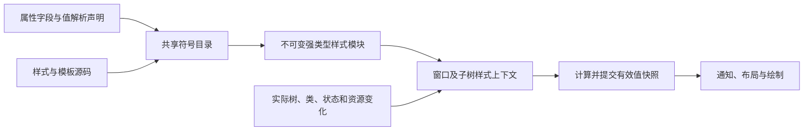

# 23 · 可扩展样式系统重设计

> 状态：**设计提案，尚未实施**。2026-11-13。
> 本文定义下一版的目标契约；示例 API 均为拟议 API，不代表当前源码已经提供。
> 实施后替代 design/17、design/19 的样式机制，并同步 spec/02、spec/04。
> 当前实现仍以 spec 为准；本提案不改变现有编译器或运行时行为。

2026-11-14：控件模板和主题模块的第一阶段已单独实施，见 [design/28](./28-lookless-controls.md)。
该实现不表示本提案的通用资源、选择器和新旧值层统一已完成。

## 0. 作者入口：先看语法

阅读顺序：本节看作者写法，§5.1 查选择器，§3.1 看复杂类型转换，§9.1–§9.3 看 IDE 候选。

### 0.1 样式表

采用类 SCSS 的块语法。属性名使用大小写敏感的 CLR 名称，声明以分号结束；支持 `//` 和 `/* */` 注释。
下面假定第三方 Badge 已公开 Glow、Tone、Caption 属性，Tone 的类型是包含 Success 的枚举：

```scss
@using Acme.Controls

.card {
    Background: theme(#202020, #ffffff);
    Padding: 8 16;
    CornerRadius: 12;

    &:hover {
        Background: #303030;
    }

    > Button.primary {
        Padding: 6 12;
    }
}

Badge.notice {
    Glow: 4;
    Tone: Success;
    Caption: "Ready";
}
```

框架属性与第三方属性使用相同语法；类型和转换行为由属性目录决定。
例如 `Padding: 8 16` 的两项含义来自 Padding 的类型解析器，样式语言本身不硬编码内边距规则。

### 0.2 模板、组件内样式和内联样式

```xml
@namespace Demo
@using BubuUI.Elements

@style {
    .primary {
        Background: #336699;
        &:hover { Background: #4477aa; }
    }
}

<StackPanel Class="card">
    <Button Class="primary" Style="Padding: 6 12; CornerRadius: 8;">OK</Button>
</StackPanel>
```

`.bss` 是可安装的样式模块，`@style` 的规则限定在组件实例子树中。
`Class` 为元素添加类名，`Style` 只接受声明列表，属性绑定和类型转换规则与样式表相同。
内联 Style 在模板根写 template 层，在使用点或普通子项写 local 层，沿用 §4 的值层契约。
上述 card 来自已安装的外部样式表；primary 来自本组件 sheet。

### 0.3 值的书写形式

| 写法 | 解释 |
|---|---|
| `Glow: 4;` | 按目标数字类型转换 |
| `Tone: Success;` | 按目标枚举的成员表绑定 |
| `Caption: "Ready";` | 字符串字面量 |
| `Padding: 8 16;` | 原文交给 Padding 类型的字面量解析器 |
| `Background: #336699;` | 原文交给颜色类型解析器 |
| `Glow: theme(8, 4);` | 两个分支都按 Glow 的类型转换，暗色取前者、亮色取后者 |
| `Padding: theme("8 16", "6 12");` | 任意复杂类型同样可使用主题分支 |
| `Background: resource(Palette.Accent);` | 绑定与目标类型兼容的资源键 |

复杂值可加引号；字符串属性按字符串规则处理。带引号的正文不会误识别为 theme/resource 调用。
`theme()` 和 `resource()` 是引擎级组合器，其余字面量由目标类型负责解释。

## 1. 核心决策

**样式是属性系统的一种值来源。框架、应用和第三方库使用相同的属性声明、类型转换、级联与失效机制。**

“可扩展”必须同时满足以下条件：

1. 新属性在自己的程序集声明，不修改框架或编译器。
2. 任意闭包值类型 `T` 可成为属性类型，不受 number/color/enum/string 白名单限制。
3. 同一个属性天然支持常量、主题分支和类型化资源引用，不另设 `XxxResourceProperty`。
4. 可声明适用类型、继承、默认值、校验、归一化及布局/绘制影响。
5. 模板直赋、C# 赋值、内联 Style 和样式表使用相同属性身份与校验机制。
6. 编译器、生成器和 IDE 使用同一份符号派生目录；内建属性没有特权通道。

为保证这些条件，采用以下决策：

| 方面 | 决策 |
|---|---|
| 属性来源 | 标注的强类型属性字段是唯一入口；移除从 StyleBuilder 方法反推目录的机制 |
| 属性身份 | CLR 字段符号对应唯一属性对象；短名只用于源码查找 |
| 值类型 | 使用目标类型的字面量解析元数据；无法写字面量的 T 仍可经 C# 或资源使用 |
| 主题 | 主题与资源是 `ValueSource<T>`，与普通值竞争同一个属性槽 |
| 级联 | local > template > style > inherited > default |
| 规则匹配 | 编译成类型化选择器描述；变化驱动的运行时匹配 |
| 更新 | 先计算最终快照，再原子提交，随后通知与失效 |
| 作用域 | Application → Window → 元素子树，依托实际内容树 |
| 属性消费 | 控件布局或绘制实现显式读取属性；目录记录适用性 |

本轮样式目标是 Element。Window 提供窗口级 StyleContext；它的普通 CLR 属性仍经模板或 C# 赋值。
属性模型可以继续扩展到其他 UiObject，但不把它作为本轮实施的前置依赖。



## 2. 属性声明：一条通道覆盖框架和第三方

### 2.1 强类型声明

保留 `StyledProperty<T>` 作为属性句柄基类，增加包含声明目标类型的派生句柄：

```csharp
public sealed class StyledProperty<TOwner, T> : StyledProperty<T>
    where TOwner : Element
{
    public static StyledProperty<TOwner, T> Register(
        string name, PropertyMetadata<T> metadata);
}
```

当前 `StyledProperty<T>` 的 sealed 限制需要解除。声明目标进入字段类型，编译器通过 Roslyn
直接读取 `TOwner` 与 `T`，无需执行初始化器、推测 Register 调用或再维护一个 Owner 特性参数。
现有 `GetValue<T>` / `SetValue<T>` 继续接收基类句柄；同一属性不会因增加使用者而复制存储。

第三方控件示例：

```csharp
public class Badge : Element
{
    [UiStyleProperty]
    public static readonly StyledProperty<Badge, double> GlowProperty =
        StyledProperty<Badge, double>.Register(nameof(Glow), new()
        {
            Default = ValueSource.Constant(0d),
            Validate = static value => double.IsFinite(value),
            Normalize = static value => Math.Max(0, value),
            Effects = PropertyEffects.Render,
        });

    public double Glow
    {
        get => GetValue(GlowProperty);
        set => SetValue(GlowProperty, value);
    }
}
```

`[UiStyleProperty]` 仅负责源码可见名称：默认取字段名去掉 `Property` 后缀，允许显式 `Name`。
属性类型、适用目标及运行行为由字段句柄和 metadata 提供；不在特性与注册参数中重复声明 Owner。
字段必须可从生成调用处访问、public static readonly，声明类型与 T 均为闭包类型。
框架自己的 Background、Padding、FontSize 等也使用这一通道。

`StyleBuilder.Background(...)` 等便捷方法可以作为普通包装保留，但不参与属性发现。
生成器统一发射泛型 `Set(property, valueSource)`，不再保存 `IsBuiltIn` 分支。

Register 只创建句柄，不再向 `(OwnerType, Name)` 全局唯一表登记。注册字符串用于调试，
不充当跨库身份；两个静态宿主可以给 Element 声明同短名属性。生成的模块 manifest
将 canonical 字段身份绑定到句柄对象，负责目录查找与重复身份检查。没有模块的纯 C# 属性仍可直接使用句柄。

### 2.2 属性元数据与写入约束

```csharp
public sealed class PropertyMetadata<T>
{
    public required ValueSource<T> Default { get; init; }
    public bool Inherits { get; init; }
    public PropertyEffects Effects { get; init; }
    public Func<T, bool>? Validate { get; init; }
    public Func<T, T>? Normalize { get; init; }
    public IEqualityComparer<T>? Comparer { get; init; }
}

[Flags]
public enum PropertyEffects { None = 0, Measure = 1, Arrange = 2, Render = 4 }
```

- 原始输入先 Validate，再 Normalize，再校验归一化结果，最后保存。默认值同样经过验证。
- 例：复合 Padding 检查各分量为有限数，Normalize 将负分量钳至 0；FontSize 可以直接拒绝非正数。
- 这些函数必须纯粹、确定，且仅依赖传入值；本轮不引入读取其他属性的 coercion。
- C#、模板、style、主题和资源解析后的 T 都走该机制。CLR setter 只作属性句柄包装。
- 比较器比较最终有效值；Measure 隐含 Arrange 和 Render，Arrange 隐含 Render。
- 运行时校验必须存在；编译期只对内建字面量规则和已声明格式约束提供可证明的检查。
- 编译器不执行用户 Validate、Normalize 或 Parse；无法静态证明的业务约束在运行时检查。
- 共享规则内的 T 应为不可变值。需要可变对象的属性，由属性作者显式管理对象变更的失效通知。

### 2.3 声明目标与实际使用者

属性的声明目标是默认适用类型，但不是唯一可消费类型。例如 FontSize 定义在文本属性宿主上，
Button 也会读取它。增加显式的复用声明：

```csharp
[UiConsumesStyleProperty(typeof(TextStyles), nameof(TextStyles.FontSizeProperty))]
[UiConsumesStyleProperty(typeof(LayoutStyles), nameof(LayoutStyles.PaddingProperty))]
public class Button : Element { /* 测量和绘制读取上述属性 */ }
```

目录据此形成 `ApplicableTypes`：声明目标及其派生类，加上显式使用者及其派生类。
第三方可对自己的控件声明使用任意公开属性。一个属性对象始终对应一个存储槽。

附加属性也通过公开的 canonical StyledProperty 句柄加入相同目录；已有 AttachedProperty
包装继续转发到该句柄，不建立第二套 class 层存储。其作用对象由句柄 TOwner 和使用者声明决定。
普通 CLR 属性的模板可写性保持现行契约；要获得样式级联与撤销能力，应注册属性句柄。

适用性规则：

- 类型选择器或内联 Style 已知目标不适用：编译错误。
- 只有类名的规则可能服务多个目标：允许编译；实例匹配时检查适用性。
- 匹配后发现不适用：跳过 setter，提供带规则/属性/目标类型的诊断，每种组合去重。
- C# 直接对不适用对象写属性：抛有类型信息的异常，不留下不可消费值。

声明使用能力不能证明绘制代码确实读取属性，因此每个控件仍需布局/绘制契约测试。
布局消费与视觉消费都合法；可扩展属性不要求一定产生像素。

### 2.4 名字查找和跨库冲突

属性的稳定身份是程序集身份与完整字段元数据名，运行期由该静态字段对象承载。
`Glow` 是书写短名，不是全局唯一的属性注册键。

`.bss` 引入与 `.bui` 一致的 namespace / using / using alias 查找能力：

```scss
@using Acme.Controls
@using BadgeProps = Acme.Controls.Badge

Badge.notice {
    Glow: 4;
    BadgeProps.Glow: 6;
}
```

带点属性名按类型/别名限定解析，最后一段定位标注字段的样式名。内建 BubuUI 命名空间隐式导入。
普通短名在导入范围内查找；目标类型已知时再按适用性过滤。多个合法候选报歧义并给限定名建议。
不同库可以各自拥有 Glow，不因项目新增引用而把双方从目录删除，也不设置“内建优先”。
同一属性的多个公开字段别名不受支持；复用通过引用 canonical 字段完成。

## 3. 值扩展：语法只负责结构，目标类型负责转换

### 3.1 值解析分两层

第一层只识别稳定的语法结构：字符串、标量、标识符、列表、函数与引用，并保留原文 span。
读取声明值时，消费到当前括号/引号层级的 `;` 或块结束，不再假定一个值只占一个 token。

第二层由目标类型 T 的 converter 描述绑定字面量。目录记录返回类型、静态调用目标、
可选格式约束、候选值及提示文字；Emitter 不按 Background、Thickness 等名字分支。

| 类型 | 字面量绑定 |
|---|---|
| primitive / enum / string / nullable | 框架提供通用转换规则 |
| Color、Thickness 等框架结构 | 与第三方相同的解析元数据 |
| 用户类型 | 复用 `[UiLiteralParser]` 声明 public static T Parse(string) |
| 无法修改的外部类型 | 新增 parser-provider 声明，指向返回该 T 的公开静态方法 |
| 没有字面量解析器的 T | 允许 C# 常量对象与 `resource(...)`；字面量使用点报告缺少转换器 |

类型自带解析器是缺省。外部 provider 在解析器静态类上声明
`[UiLiteralParserFor(typeof(T), ParseMethod = "Parse")]`，格式和候选参数与 UiLiteralParser 相同。
使用点通过模块级 `@converter External.Value = App.ValueParser;` 显式选择；类型名遵循导入规则。
该指令同时适用于 `.bui` 的字面量与内联 Style，避免同一文件内产生两套转换约定。
同一模块对同一 T 选择多个 provider 报歧义。仅引用库不产生全局覆盖。
provider 声明只描述类型和方法，不加载或执行用户程序集。
带 Pattern 的解析器沿用超时与确定性校验要求；无 Pattern 时只能保证签名，不能宣称业务值已通过校验。

以下用 Thickness 展示完整过程。假定 Padding 句柄的 T 为 Thickness：

```csharp
using System;
using System.Globalization;
using System.Linq;

[UiLiteralParser(
    ParseMethod = nameof(Parse),
    Hint = "一个、两个或四个有限数字；两项为上下、左右，四项为上、右、下、左",
    Candidates = new[] { "0", "4", "8", "8 16" })]
public readonly record struct Thickness(double Left, double Top, double Right, double Bottom)
{
    public static Thickness Parse(string text)
    {
        var parts = text.Split(new[] { ' ', '\t', '\r', '\n' },
            StringSplitOptions.RemoveEmptyEntries);
        var numbers = parts.Select(part => double.Parse(part,
            NumberStyles.Float, CultureInfo.InvariantCulture)).ToArray();
        if (numbers.Any(value => !double.IsFinite(value)))
            throw new FormatException("Thickness requires finite numbers.");

        return numbers.Length switch
        {
            1 => new(numbers[0], numbers[0], numbers[0], numbers[0]),
            2 => new(numbers[1], numbers[0], numbers[1], numbers[0]),
            4 => new(numbers[3], numbers[0], numbers[1], numbers[2]),
            _ => throw new FormatException("Thickness requires 1, 2 or 4 numbers."),
        };
    }
}
```

```scss
.card {
    Padding: 8 16;
}
```

对应流程：

```text
Padding: 8 16;
    → 解析声明结构，保留值原文 "8 16" 和 span
    → 从目录解析 Padding 字段，读取 T = Thickness
    → 绑定 Thickness 的 UiLiteralParser 元数据
    → 校验解析方法签名；有 Pattern 时进行格式检查
    → 生成 Thickness.Parse("8 16") 调用
    → 模块实例化时得到 Thickness(Left:16, Top:8, Right:16, Bottom:8)
    → 通过属性 metadata 校验/归一化，保存为规则的常量值来源
```

生成调用的概念形态：

```csharp
rule.Set(
    LayoutStyles.PaddingProperty,
    ValueSource.Constant(Thickness.Parse("8 16")));
```

LayoutStyles 是该例的 canonical 字段宿主，Padding 的声明目标为 Panel；Button 通过消费声明复用它。
编译器不执行上面的 Parse。该例未提供 Pattern，所以项目编译只能验证签名，格式或项数错误
由模块实例化时的 Parse 报告；Hint 和 Candidates 都不具有校验能力。
提供 Pattern 后可以提前拒绝不匹配的文本，但 Pattern 仍不能证明任意 C# 业务逻辑一定接受该值。

复合字面量加引号时剥离引号并解码转义，再交给 Parse，始终保留原 span 映射诊断。
converter 在样式模块实例化时对每个字面量求值一次，theme 的两个字面量分支也在此时构造；
匹配、hover、Measure 和绘制阶段不重复解析。内联 Style 的字面量在对象初始化时转换一次。
Parse 异常包装为包含属性、原文和源位置的样式加载错误，按 §6 的失败契约处理。

### 3.2 统一 ValueSource<T>

```csharp
// 概念 API；具体表示可用泛型节点 + 非泛型接口，不要求把 T 装箱为 object。
ValueSource<T>.Constant(T value)
ValueSource<T>.Theme(ValueSource<T> dark, ValueSource<T> light)
ValueSource<T>.Resource(ResourceKey<T> key)
```

`theme(...)` 和 `resource(...)` 是泛型语法组合器，不是颜色转换器：

```scss
Badge.notice {
    Background: theme(#222222, #ffffff);
    Glow: theme(8, 4);
    BadgeProps.Inset: theme("8 16", "6 12");
    Background: resource(Palette.Accent);
}
```

- 两个 theme 分支都按当前属性 T 绑定；任何可解析的 T 均可使用。
- theme 双参数是 Dark/Light 模式的语法糖；品牌、多套主题通过命名资源字典表达。
- `ResourceKey<T>` 与属性 T 必须一致；nullable 按明确的可空提升规则转换，不做任意隐式类型猜测。
- 允许组合，例如 `theme(resource(Palette.DarkAccent), resource(Palette.LightAccent))`。
- C# 增加 `SetValueSource`，默认写 local；模板 scope 内写 template。样式声明写 style。
- `SetValue(property, value)` 等价于该层的 Constant；`ClearLocalValue` 才是撤销覆盖。
- null 是可空 T 的真实值，占据当前层；Unset 是引擎内部的“无候选”标记，两者不同。

同一 Background 的主题值、常量值和资源值竞争同一个槽。胜出来源确定后才解析值，
因此 class theme 不会越过 local 常量，后声明的静态变体也能覆盖主题基础值。

### 3.3 类型化资源

资源键也由公开静态字段声明，编译器通过泛型参数读取类型：

```csharp
public static class Palette
{
    public static readonly ResourceKey<Color?> Accent = new("Acme.Accent");
}
```

资源键以 canonical 字段/句柄为身份，构造字符串用于可读诊断；不同库的同短名键不会互相覆盖。

资源字典按 Application → Window → 子树作用域逐级覆盖，查找时从最近作用域开始。
资源存在性与当前取值分开：键已声明但没有当前资源值，在该来源实际获胜时报告解析错误。
不静默降级为低优先级规则，也不把“资源值为 null”解释为资源缺失。

资源和默认值来源允许引用资源，但不允许引用属性值，避免属性依赖图隐式成环。
资源引用之间建立依赖图；作用域字典提交前检查类型、缺失及循环。
主题/字典替换先预计算受影响的有效值，失败则拒绝本次变更，成功后批量提交。
仅被遮蔽的来源不必解析；清除高层覆盖时会重新解析下层来源。

## 4. 级联：值层与规则顺序分别定义

有效来源依次查找：

```text
local > template > style > inherited > default
```

template 沿用当前根属性默认值契约。值层与 ValueSource 的种类无关。
继承读取父节点已经解析和归一化后的有效 T；default 可使用类型化主题资源。
父关系变化必须重新计算继承与有效状态；断开树后使用独立上下文中的默认来源。
需要被外部样式覆盖的控件缺省外观应放在 default 或默认样式中；模板中显式写出的值仍遵守 template 层优先级。

style 层内部按如下键比较，较大者胜：

```text
(作用域深度, 选择器 specificity, 模块安装序, 规则源码序, 声明源码序)
```

- 子树作用域优先于外层；每条规则只能影响自身作用域内的实际节点。
- specificity 为 `(类/状态数量, 类型数量)` 的字典序比较；不支持 ID、important 和任意数值优先级。
- 嵌套先展开为完整选择器再计算 specificity；`>` 不增加权重。
- 同优先级按真实源码序逐声明比较，保留交错状态声明顺序，不按状态名称聚组。
- 同模块重复选择器允许按源码合并语义；跨模块顺序由显式安装序决定。
- 生成器默认模块表以规范化的项目相对路径 Ordinal 排序，诊断显示该顺序；不依赖绝对工作目录。

**Class 列表作为集合使用，顺序不再决定规则优先级。** `Class="a b"` 与 `Class="b a"`
行为一致。这是明确的破坏性变化；模板类和调用方类合并去重。调用方强制覆盖值使用 local，
主题覆盖使用近作用域规则。迁移检查需定位依赖类数组顺序的现有写法。

## 5. 选择器：编译规则，按变化匹配

### 5.1 支持范围

首版的完整选择器范围如下：

| 选择器 | 含义 |
|---|---|
| `Button` | Button 及其派生类型 |
| `.primary` | 带 primary 类的元素 |
| `.primary.large` | 同时具有 primary 和 large 两个类 |
| `Button.primary` | 类型与类同时满足 |
| `Button:hover` | 类型与状态同时满足 |
| `Button:hover:pressed` | 两个状态同时满足 |
| `.card > Button` | card 的直接子元素 |
| `.card Button` | card 的任意层级后代 |
| `.card > StackPanel > Button` | 完整结构链，只有终点 Button 得到声明 |
| `.card { > Button { ... } }` | 展开为 `.card > Button` |
| `.card { Button { ... } }` | 展开为 `.card Button` |
| `.primary { &:hover { ... } }` | 展开为 `.primary:hover` |

类交集、类型和多个状态可组合在同一段，关系段也可连续组合：

```scss
Badge.notice { Glow: 4; }
.card > Button.primary:hover { Background: resource(Palette.Accent); }
.panel { > Button { CornerRadius: 12; } }
```

类型名使用短名或 using 别名，命名空间通过 `@using` 引入；类型后的点号表达类约束。
同一段中的类和状态都是 AND 条件。`&` 只能在嵌套选择器开头引用完整父选择器，
后面可以附加类/状态或继续结构关系；顶层使用 `&` 报错。

平台状态为 `:hover`、`:pressed`、`:focus`、`:disabled`。自定义状态必须由控件声明，
例如 Badge 声明 loading 后可写 `Badge:loading`；任意未知状态拼写报错。
首版不支持 `#id`、`*`、属性选择器、兄弟关系 `+` / `~`、`:not()` / `:has()` 或逗号选择器列表。
这些语法报告“不支持的选择器”，不能静默跳过或误当成类名。

类型解析遵循导入/别名及真实 CLR 身份，匹配包含派生类型。运行时使用生成的类型测试或类型句柄表，
类名和状态预先绑定成键；没有运行时文本解析、反射扫描或 CSS 字符串选择器解释器。

取消 BEM 派生名生成与 Classes 自动注入；嵌套保留完整结构关系。
匹配必须走完全部链段才应用目标规则，中间节点不会收到最终规则的 setter。
直接子与后代关系分别编码，不以人类可读的派生类名充当规则身份。

控件代码/输入路由维护状态键，规则只读。框架不默认把 IsEnabled、Checked 等行为输入公开为样式属性，
避免样式直接改变自己的匹配条件。第三方回调仍可能构造反馈环，由更新轮次上限及规则来源诊断报告；
编译器不承诺分析任意 C# 回调的依赖。
平台状态保留快速位测试，自定义状态使用类型化键，不把进程内固定数量的全局位当作扩展上限。

自定义状态的拟议声明形式如下，补全与绑定均读取同一声明：

```csharp
[UiPseudoState("loading", nameof(LoadingState))]
public class Badge : Element
{
    public static readonly PseudoStateKey LoadingState = new("Acme.Badge.Loading");

    public void SetLoading(bool value) => SetState(LoadingState, value);
}
```

扫描验证公开静态只读键字段、名称冲突及继承关系，产出 StateDescriptor。
字符串用于诊断，canonical 字段/键对象用于运行时身份。同名继承声明若指向不同键则报歧义，
不得用偶然扫描顺序覆盖。只有类名的选择器引用自定义状态时，必须在当前导入范围内唯一解析该名字；
有多个候选则要求补类型约束。控件不支持已解析状态时该条件不匹配。

### 5.2 变化与调度

| 变化 | 至少重算 |
|---|---|
| 自身类、类型能力或状态变化 | 当前元素；存在相关祖先条件时还包括后代 |
| 父节点改变、节点插入/移出 | 移动子树的作用域、结构匹配、继承、有效禁用状态 |
| 祖先类或祖先状态变化 | 依赖该祖先条件的后代；首版允许保守标记整棵子树 |
| 规则模块安装/移除 | 所属作用域受影响子树 |
| 资源/主题变化 | 依赖相关资源或模式的有效来源 |
| local/template 清除 | 当前属性重新选择来源，并传播有效继承变化 |

匹配在更新队列中、Measure 前完成；C# 样式读取使用 EnsureStylesCurrent 保证读到当前结果。
实现必须处理批内查询重入：提交前仅向内部计算器暴露下一快照，用户通知在提交后执行。
样式事务或未完成的树构造期间不提供“已经完成全树更新”的保证；普通 API 返回后读取会刷新必要路径。

所有树、样式和值的变更在 UI 线程提交；后台任务只能投递更新，不读取或修改匹配结构。
索引按目标类型、类和状态减少候选规则；第一版先采用保守的子树失效保证正确性。
静止帧不重新匹配。选择器从目标向祖先匹配，使用链段/祖先位置的动态规划避免重复回溯，
单候选最坏工作量按祖先深度 × 链长计；总成本还取决于受影响节点数与候选数。
当一条规则涉及祖先状态时，该状态变化带来的后代工作是语义所需，应纳入独立性能预算。

## 6. 样式提交：计算快照，再发布变化

每次更新批次分为四步：

1. 根据已提交树关系、类、状态、上下文版本，计算匹配规则与每个属性的胜出来源。
2. 解析有效值，运行校验/归一化，按父在前的顺序计算受影响的继承值；建立下一快照及资源依赖。
3. 全部计算成功后交换受影响节点快照，使回调读取到同一批已提交结果。
4. 只为有效 T 改变的属性发一次通知，合并布局/渲染影响，排入必要的后续更新。

禁止“ClearStyleValues + 逐条 setter”实现规则切换。基础值、默认值和各变体的中间状态不向用户发布。
同值换来源只更新来源/依赖信息，不发 PropertyChanged，不触发 Measure。
继承传播在本地遮蔽点停止；该节点自身资源依赖或结构条件变化仍独立处理。

计算/解析/校验失败时保留上一份已提交属性快照并向宿主报告。初始化尚无旧快照时使构造失败，
沿当前 UiConstructionScope 清理。已提交后回调抛异常不承诺撤销用户副作用，沿现行宿主异常契约传播。
回调引起的新状态或新树修改进入下一批；禁止在通知过程中递归执行同一提交。

属性版本负责值造成的缓存失效；直接绘制输入（例如没有样式覆盖时的 pressed 外观）
仍由渲染器状态键处理。状态变化不必伪造属性通知来强迫重绘。

## 7. 上下文、组件样式与装配

```text
Application.StyleContext
  └─ Window.StyleContext
       └─ Element.StyleScope（可选）
            └─ 子树 StyleScope（可选）
```

共享的 StyleSheet 是不可变定义，可跨窗口复用；匹配快照、资源依赖和元素引用属于各 StyleContext。
不再通过静态 Styling.Provider、StyleRegistry.Instance 或强引用 PendingClasses 列表持有活实例。

应用装配顺序固定为：收集模块 → 实例化/校验模块与资源 → 建立上下文 → 挂接树 → 首次样式刷新。
提前构建的树在挂接时获得上下文，不需要在全局静态列表等待补应用。

组件 `@style` 生成静态不可变 sheet；实例初始化只登记“本实例根上的 sheet”。
挂接时安装到实际 StyleContext 中本实例的子树作用域，移树时重新绑定，释放时注销。
脱离树的根使用按需创建的独立上下文，同样安装本实例及其子树的 sheet；挂接时重新绑定完整作用域链。
独立上下文仅由所属根持有，释放/移入活动上下文时清理订阅，不进入全局等待列表。
不存在进程级“注册过一次，因此这个 Registry 一定也有定义”的布尔守卫。
基类与派生类在同一根上的 sheet 按初始化继承顺序安装，派生 sheet 的安装序靠后。

组件样式身份包含程序集、完整类型名及模块内规则编号。类名保持作者原文，不再生成
`文件短名__类名`；不同命名空间的同名组件互不冲突。作用域是每个实际根实例的子树，
插槽内容按最终树位置匹配；没有与内容树平行的组件所有权树。
Window 或祖先作用域的规则仍可匹配内部元素，较近作用域按第 4 节获胜；这是一套子树级联规则，
不宣称提供 Shadow DOM 式封装。

## 8. 属性消费与渲染解耦

可写属性、有效属性值和绘制行为分别验证：

- 通用背景、边框、圆角、焦点环进入统一元素装饰阶段，读取 canonical 属性。
- Button、CheckBox 等内容绘制只负责控件内容与特有状态；布局读取声明支持的 Padding/FontSize。
- 控件默认视觉值迁移到默认来源或主题规则，不由 painter 的硬编码值覆盖用户有效值。
- 第三方布局和 renderer 通过公开的控件/渲染扩展接口读取自己的属性，不修改中央类型 switch。
- 框架只对已经实现消费与测试的控件发布 UiConsumesStyleProperty 声明。
- 复杂效果可以由自定义 renderer 消费；单纯注册 Glow 不会自动创造发光绘制算法。

统一装饰阶段也尊重透明协调节点和裁剪契约。背景为 null 时保持透明；主题 surface 由窗口表面负责，
根元素显式背景照常作为元素装饰绘制。圆角用于该元素的背景、边框及焦点环，避免三套半径不一致。

## 9. 编译产物、IDE 与可观测性

目录分成四类纯数据记录：

1. `PropertyDescriptor`：字段身份、T、声明目标、使用者、公开名及文档。
2. `ValueConverterDescriptor`：目标 T、静态 Parse 调用、格式约束、候选及来源。
3. `StyleModuleDescriptor`：有序规则、完整 selector 链、typed setter、source span、资源键与安装身份。
4. `StateDescriptor`：公开状态名、canonical 键字段、声明控件及继承适用范围。

运行时行为 metadata 保留在属性对象；编译器通过类型和声明进行静态检查，不读取委托执行结果。
以上纯数据字段完整参与 Equals/GetHashCode，不持有 Roslyn Symbol、SyntaxTree 或活对象。
只引用 Runtime 的项目仍可发现自己的样式属性，目录构造不依赖 Rendering.StyleBuilder 是否存在。

生成产物直接引用属性/资源字段和解析方法，构造不可变选择器描述与泛型值节点，满足 AOT/trimming。
库通过生成的公开模块入口显式安装；应用生成默认模块表。模块安装顺序可见、可重复、可卸载。
不依赖程序集加载顺序、反射探测或用户静态构造器的偶然先后。

提供 `ExplainValue(element, property)` 调试入口，至少返回：

- 当前有效值、来源层、获胜规则及原始 span；
- 被遮蔽候选及其比较键；
- 资源键、解析作用域与版本；
- 不适用声明和校验失败信息。

沿用现有诊断码覆盖的类别；新增类别在实施时分配新码，不复用 spec/04 已停用的码。

### 9.1 候选按光标上下文计算

IDE 与编译器共用上述目录，不为内建属性或第三方属性另建补全表。
其中 `│` 表示光标，不属于样式语法：

| 输入位置 | 候选及来源 |
|---|---|
| `@using Ac│` | 当前项目符号中的命名空间与可用类型别名目标 |
| `But│` | 导入范围内的控件类型，显示完整类型名和程序集 |
| `.pri│` | 项目已声明/静态使用的类名，显示来源；允许作者直接声明新类 |
| `Button:│` | 平台状态及 Button 自身/继承声明的自定义状态 |
| `Button { │ }` | PropertyDescriptor 中适用于 Button 的属性，包括显式消费属性 |
| `BadgeProps.│` | 已解析宿主的公开样式属性；有目标类型时再按适用性过滤 |
| `Tone: │` | 目标枚举成员，例如 Success、Danger |
| `Padding: │` | Thickness converter 的 Candidates、Hint，以及通用 theme/resource 片段 |
| `Background: │` | 颜色 converter 的候选/字面量片段，以及通用 theme/resource 片段 |
| `Padding: theme(│, 4)` | 沿用 Padding 的目标 T，提供当前分支的 Thickness 候选 |
| `Background: resource(│)` | 当前可访问、与目标 T 兼容的 ResourceKey 字段，显示键名及类型 |
| `@converter External.Value = │` | 目标为 External.Value 且签名合法的 parser-provider |

基本属性候选条件为：导入可见、可从生成代码访问、标注有效、目标类型适用。
类型适用性包含声明目标、继承和 UiConsumesStyleProperty，不能只比较字段所在类或 TOwner。
同名属性都保留候选，并为歧义项插入类型/别名限定名；不能选一个候选后让编译器绑定到另一个。
类名候选只来自静态项目事实，不推测 C# 运行时字符串；类选择器本身也可声明一个新类。

只有类名的 `.primary { │ }` 没有确定目标类型，显示当前导入范围内的属性并标注适用控件。
不能依据当前项目中碰巧出现的 Class 使用点，把候选永久过滤成某个控件子集。
`.card > Button.primary { │ }` 的最终目标则明确为 Button，不使用祖先 card 的类型过滤声明。
未知类型或未完成选择器采用保守候选，并保留诊断，不伪造一个目标类型。

### 9.2 值候选、插入文字与文档

- primitive 提供通用值/片段，枚举成员来自符号目录，复杂类型使用 Candidates/Hint/Pattern。
- Candidates 是建议而非枚举约束；不在列表中但 Parse 接受的文本仍合法。
- converter 可声明字面量片段，例如颜色的 hex 模板；Color 与第三方类型使用同样的片段元数据，
  由 ValueConverterDescriptor 携带到 IDE，不能在 CompletionProvider 中根据 Color 类型名硬编码。
  对应地扩展 UiLiteralParser/UiLiteralParserFor 的可选 Snippets 元数据；片段使用 LSP snippet 约定。
- theme/resource 候选对所有 T 统一提供。theme 分支继承外层属性 T；资源过滤使用同一套类型兼容规则。
- 在引号内只替换候选正文，必要字符按字符串规则转义；引号外的候选携带完整字面量或明确的片段。
- 每个 CompletionItem 给出准确替换 span、插入文字、类型、适用目标、来源和说明，排序保持确定性。
- hover 展示属性类型/适用控件以及解析格式；若是资源，展示键的 T 与声明位置。
- 无 converter 时，属性仍显示在候选中；值位置说明“该类型没有字面量解析器，可使用资源或声明解析器”。
- 无 Pattern 时说明“格式由加载时 Parse 检查”；不能因为存在 Hint/Candidates 就显示为编译期已校验。

### 9.3 未完成文本与增量行为

语法分析器必须生成错误恢复节点和缺失 token，至少保留所属规则、已识别属性、值原文及括号层级。
例如 `Padding: 8 │`、`Padding: theme(8, │`、`Background: resource(│` 都能恢复目标类型并提供候选。
在声明结束符或块边界同步恢复，单条错误不能让整个文件后续规则失去补全。

候选查询使用文档版本一致的目录、导入、语法树和 converter 选择快照；旧版本异步结果不得覆盖新版本。
文档修改优先重建局部语法；类型 API、引用库、导入或解析声明变化时使相关目录/绑定缓存失效。
LSP 不执行用户 Parse/Validate/Normalize，不实例化属性句柄，不为了给候选而启动应用。
`.bss`、`.bui` 的 @style、Style 属性共享语义服务，只由各自入口映射光标与替换 span。

## 10. 实施切片与验收

按依赖顺序实施，每片包含实际实现、测试和对应 spec 更新；本提案本身不提前改写现行 spec。

| 片 | 工作 | 主要改动位置 | 出口 |
|---|---|---|---|
| S1 属性核心 | 强类型 owner 句柄、metadata、ValueSource 常量骨架、统一校验、使用者声明 | Runtime/PropertySystem、UiAttributes、Element；Compiler.Metadata | 运行时与第三方属性同通道；所有写入层行为一致 |
| S2 目录与值 | 单一字段目录、目标类型 converter、限定名、复合值、候选/片段元数据及共享补全语义服务 | StylePropertyCatalogFactory、BssAst/Parser/Generator、IDE | 第三方程序集新增复杂类型属性，无编译器改动即可生成并运行；属性和值补全自动出现 |
| S3 来源与资源 | ValueSource<T>、typed key、上下文、默认来源、原子快照 | Runtime 属性存储、Rendering/Visual、AppBuilder | 任意 T 的主题/资源与 local/template 正确级联；中间值不泄漏 |
| S4 规则与树 | 完整选择器、状态声明目录、级联比较、变化索引、挂接传播 | BssCollapse 替换、TemplateGenerator、Emitter、ElementCollection | 动态类、树移动、多层链和交错状态正确；自定义状态可诊断/补全；静态 BEM 注入退出 |
| S5 视觉闭环 | 通用装饰、内建属性迁移、控件消费、上下文装配 | ElementPainter、Controls、Panels、Window 宿主 | 圆角/内边距等实际生效；多窗口、独立 Registry 等价场景隔离 |
| S6 清理与工具 | 移除旧通道、迁移 Gallery、ExplainValue、性能与文档 | samples、tests、IDE、design、spec | 无平行旧机制，样例和规范使用同一套 API |

S3 的快照与上下文是 S4 的前置条件；S4 完成后再整体切换生成器。
迁移期间可短期使用显式适配器把旧 Define 转成新 sheet；最终删除适配器，不保留两套优先级。

必须新增以下验收，而不只测试解析字符串：

1. **真正的第三方闭环**：独立类库声明自定义属性与自定义结构类型；宿主只添加引用和样式，完成真实生成编译、加载、读取与绘制。
2. **无渲染依赖目录**：仅 Runtime + 用户属性库也能编译样式模块，支持非视觉布局属性。
3. **同等扩展**：自定义数字/枚举/字符串/结构类型均支持常量、theme、resource、inline、状态与继承。
4. **值层矩阵**：五层与三种值来源交叉，class theme 不能覆盖 local 常量；null 与清除覆盖分别验证。
5. **匹配金标准**：直接子/后代、两层以上嵌套、无终点链、派生类型、别名、动态类、条件块与插槽树位置。
6. **状态顺序**：hover/pressed/disabled/自定义状态交错重复声明，对比真实源码序的获胜结果。
7. **原子性**：未改变的字号零通知、零重新测量；回调读到同批提交值；校验失败没有部分更新。
8. **树迁移**：加入已禁用父节点、移出、更换主题作用域、带继承覆盖点的子树移动，均即时取得正确有效值。
9. **视觉消费**：按钮圆角与 Padding、自定义 renderer 属性、背景/边框/焦点环一致；retained 与全量绘制一致。
10. **作用域隔离**：两个应用/窗口、同短名不同命名空间组件、独立主题资源、模块移除与释放后无实例残留。
11. **性能**：静止帧不匹配、不解析；状态切换不重做无关布局；分别统计候选规则数、匹配节点数、测量数与分配量。
12. **失败诊断**：歧义、不可用目标、解析错误、资源缺失/类型不符/循环、校验异常都携带可定位来源。
13. **IDE 候选**：独立第三方属性与 parser-provider 引用后自动出现；覆盖明确目标、无类型类选择器、属性重名、消费声明、资源类型过滤及引号内替换。
14. **IDE 恢复与安全**：未完成值/函数/选择器仍可补全，错误后续规则可继续分析；过期请求取消或丢弃；所有 IDE 查询均不执行用户转换器。

### 10.1 必须明确处理的迁移变化

- 旧 `BackgroundResourceProperty` / `ForegroundResourceProperty` 写入统一属性的 ValueSource，随后删除独立字段。
- 旧双通道目录退出，所有内建属性补声明；旧 `StyledProperty<T>.Register<TOwner>` 调用迁移为可静态读取 Owner 的句柄。
- Padding 可迁移为复合 Insets/Thickness；旧单数字字面量由该类型解析器解释为四边相同。
  C# 原先接收 double 的公开 setter 需要明确升级或临时 obsolete 重载，不假定二进制兼容。
- 手工使用 `panel__button` 等自动派生名的代码改为显式类或真实规则；新系统不再暗中注入该名字。
- 依赖 Class 数组顺序的覆盖改为规则源码顺序、近作用域或 local 赋值。
- 原来仅在 CLR setter 中的修正迁入 metadata，防止不同入口行为漂移。
- 组件的静态全局注册替换为实例作用域安装；跨文件同名类由显式模块序决定，不能依赖偶然注册时机。

## 11. 完成标准

拿一个框架未见过的类型 T 和一个第三方控件，作者只在自己的库中声明属性、解析器与消费实现，
宿主就能在 `.bss`、`@style`、`Style=` 和 C# 中使用该属性，并获得相同的类型检查、
主题资源、级联、继承和失效行为。整个过程不修改 StyleBuilder、编译器分支或中央控件绘制分发。

达到这一标准，才能称为属性及属性值均可扩展的样式系统。
