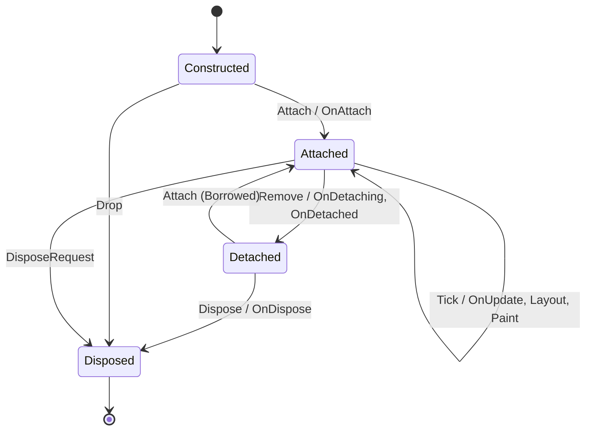

# 统一节点架构（Unified Node Architecture）设计蓝本

> 状态：**独立提案 / 从零设计**（2026-11-13）
> 定位：本文回答「不考虑任何现有项目约束时，控件与组件的二元性应当如何被消除」。
> 它不是任何仓库的规范修订，不进入 `design/`、`spec/`，不代表对现有实现的承诺或差距清单。
> 适用读者：UI 框架作者、编译器/运行时设计者、评审人。
> 度量方式：本文用**概念数**而不是特性数评价设计——见 §0.2。

---

## 0. 摘要

### 0.1 一句话

**最优解不是设计更好的控件或更好的组件，而是让「控件 vs 组件」这个问题不成立**：只有一种节点 `UiNode`，只有一条父链，只有一套生命周期；所谓控件、容器、组件只是节点上三个正交 facet 的**配置差异**，不是类型差异。生命周期是**树的性质**，不是类型的性质。

### 0.2 判据：概念数

框架作者必须同时保持一致的概念越少，设计越接近最优。目标值是七个「1」：

| # | 概念 | 目标 | 常见拆分（本设计要消除的） |
|---|---|---|---|
| 1 | 树 | 1 棵 | 逻辑树 / 视觉树、组件树 / 元素树 |
| 2 | 身份 | 1 个 | 组件实例 + 影子 adapter + 宿主控件 |
| 3 | 父链 | 1 条 | 视觉父 / 所有权父 |
| 4 | 失效队列 | 1 条 | 组件失效队列 + 属性引擎脏标记 |
| 5 | 生命周期 | 1 套 | 组件 Mount/Render/Dispose + 元素 Attach/Layout/Unload |
| 6 | 属性系统 | 1 套 | 模板参数 + 样式属性 + 附加属性三套解析 |
| 7 | 事件系统 | 1 套 | 路由事件 + 委托参数 + 生命周期通知 |

任何提案若引入第 8 个需要同步的概念，必须在 §12 登记为显式决策并说明收益。

### 0.3 设计目标

- **G1 单一身份**：节点即身份，状态挂在身份上，不产生第二个对象或影子层。
- **G2 对称生命周期**：挂载与卸载严格配对，钩子与事件同源，覆盖构造到释放全过程。
- **G3 树变更是唯一事件源**：`Children.Add/Remove` 自动驱动状态机，不存在需要手工调用的释放 API。
- **G4 一条失效管线**：从状态写入到像素提交只有一个队列、一组阶段、一套短路规则。
- **G5 编译期确定**：保留树 + 动态槽，无运行时结构 diff、无反射、AOT/裁剪安全、输出确定。
- **G6 可验证**：每个生命周期转移、每条不变量都有契约测试；无头宿主与窗口宿主走同一状态机。
- **G7 零成本抽象**：纯结构节点不分配几何字段，透传布局不引入额外遍历开销。

### 0.4 非目标

- 不做运行时任意结构重组（动态换模板/组件类型）；需要时用显式 `DynamicHost` 逃生舱（§10.4）。
- 不追求 HTML/DOM、XAML 或任何既有语法兼容。
- 不定义具体光栅化后端、字体引擎、平台窗口 API；只定义与它们交界的纯数据契约。
- 不承诺源码级迁移路径；本文是从零蓝本。

### 0.5 文档约定

**必须 / 不得 / 应当 / 可以** 按 RFC 2119 语义使用。伪码为 C# 风格，仅表达契约，不代表最终 API 命名。§4 的转移表与 §2.5 的不变量是全文形式化正本；图与示例与之冲突时以正本为准。

---

## 1. 问题定义

### 1.1 二元性从哪来

UI 框架里始终存在两种职责：

| 职责 | 关心的问题 | 典型载体 |
|---|---|---|
| **描述 / 身份 / 状态** | 「这块 UI 是谁、状态在哪、失效范围多大、资源何时释放」 | 组件实例、composition、fiber |
| **呈现 / 几何** | 「它多大、在哪、画什么、谁被点中」 | 视觉元素、render object、LayoutNode |

困难不在「有两种职责」，而在**把职责误当成类型**：一旦定义出 `Component` 与 `Element` 两个类，就必然产生两个对象图、两条父子关系、两套生命周期，以及把两者粘起来的桥（根引用、卸载事件转发、所有权接管、失效队列迁移）。桥的数量随特性线性增长，且每一处都是泄漏与时序 bug 的温床。

### 1.2 主流流派的拆分位置

| 流派 | 拆在哪 | 留下的「第二个概念」 |
|---|---|---|
| Flutter | Widget（不可变描述）→ Element（身份）→ RenderObject（几何） | 描述层与身份层并存；RenderObject 可选 |
| React | Fiber 同时承载组件与宿主实例 | 运行时 reconciliation diff；effect 与渲染分离 |
| Jetpack Compose | 组合函数不是对象，状态在 slot table，一棵 LayoutNode 树 | 组合期状态表与节点树并存 |
| Avalonia / WPF | 控件即视觉节点 | 逻辑树与视觉树双父链；模板展开成第二套父子关系 |
| Blazor | 组件实例 + DOM，renderer 桥接 | 两个世界 + 编辑序列 |

它们的共同点是**各自解决了拆分的一半**：要么身份统一了但描述层还在，要么树统一了但状态表还在，要么节点统一了但父链还在。本设计要消掉的是「需要同步的第二份事实」，而不是职责本身。

### 1.3 设计原则

- **P1 身份优先**：节点是唯一身份；状态是身份的属性，不是另一个对象。
- **P2 能力正交**：布局、绘制、状态各自是可组合的 facet，不用继承表达差异。
- **P3 默认可呈现**：每个节点都**有** `Measure`/`Arrange`；不想占位就声明为「单子透传」，而不是「没有布局」。这条是消除二元性的关键（§2.4）。
- **P4 树即生命周期**：状态机由树变更驱动，不由业务代码手工推进。
- **P5 钩子与事件同源**：`protected virtual` 与公开事件由同一状态机派生，一份事实源。
- **P6 纯函数渲染**：`paint = f(state, layout, theme)`；布局与绘制不得修改树或状态。
- **P7 编译期尽量多**：结构、更新点、类型、事件绑定全部编译期确定；运行时只执行指令。
- **P8 Fail fast**：非法状态转移、线程违规、不变量破坏在任何构建配置下都抛异常，不静默兜底。

---

## 2. 对象模型

### 2.1 单一节点 `UiNode`

```csharp
public sealed class UiNode
{
    // 唯一身份、唯一父链
    public UiNode? Parent { get; internal set; }
    public NodeId Id { get; }
    public UiState State { get; internal set; }        // §4.1
    public OwnershipPolicy Ownership { get; }          // §3.2
    public IReadOnlyList<UiNode> Children { get; }
    public Key? Key { get; }                           // §3.3

    // 三个 facet：构造期固定，运行期只读（I6）
    internal IdentityFacet Identity { get; }
    internal LayoutFacet? Layout { get; }              // null = 惰性未分配
    internal PaintFacet? Paint { get; }                // null = 惰性未分配

    internal void Attach(UiNode parent, int index);
    internal void Detach();
    internal void Dispose();
}
```

`UiNode` 是 `sealed`：差异来自 facet 组合，不来自继承。控件作者不派生节点，而是**声明一个节点配置**（§2.3），由生成器/构造函数组装。这避免了深继承链带来的「派生类偷偷改变生命周期语义」问题。

### 2.2 三个 facet

| facet | 职责 | 默认实现 | 惰性条件 |
|---|---|---|---|
| `IdentityFacet` | 状态存储、失效域、资源登记、Key、所有权、生命周期钩子 | 必须有，零字段基线实现 | 常驻 |
| `LayoutFacet` | `Measure` / `Arrange`、尺寸约束、对齐、边距、透传 | **单子透传**：约束原样交给唯一子节点，核心矩形等于子矩形 | 节点参与布局时分配 |
| `PaintFacet` | 生成 display list、命中小公差、裁剪、自绘覆写点 | **不自绘**：只下发子节点绘制结果 | 节点声明自绘/背景/边框/裁剪时分配 |

```csharp
public interface ILayoutFacet
{
    Size Measure(MeasureContext ctx, Size constraint);
    void Arrange(ArrangeContext ctx, Rect final);
    bool IsPassThrough { get; }        // 默认 true
}

public interface IPaintFacet
{
    void Paint(PaintContext ctx, in Rect bounds);   // 纯函数：只写 ctx 的 display list
    bool HitTest(in Point local, HitOptions options);
}
```

**P3 的意义**：双类型架构里最常见的反对意见是「让组件成为元素，会让 Children 里出现没有 Measure/Paint 的节点」。在透传默认下这不成立——结构节点仍然合法参与 measure/arrange/hit test/脏区，只是把约束与绘制指令转发下去。它是「零成本节点」，不是「异物节点」。

### 2.3 角色 = facet 配置

| 角色 | Identity | Layout | Paint | 备注 |
|---|---|---|---|---|
| 纯结构节点（原「组件」） | ✓ | 透传 | 转发 | 零成本；持有状态、参数、插槽、失效域 |
| 容器（Panel / Stack / Grid） | ✓ | 自定义排布 | 转发 | 子节点数 ≥ 0 |
| 叶控件（Button / Text） | ✓ | 自定义测量 | 自绘 | 有 `OnPaint` 覆写点 |
| 无绘制宿主（@if / @foreach 块） | ✓ | 透传 | 转发 | 不引入自己的间距与背景 |
| 窗口根 | ✓ | 顶层槽 | 转发 | 窗口是树根，不是外部数据类（§3.4） |

同一个 `.ui` 标签解析不再需要「它是控件还是组件」的 `Origin` 分支：目录里每个类型只声明自己的 facet 配置、属性表与事件表。

### 2.4 惰性分配与零成本透传

- facet 在 `new` 时按配置**一次性**决定，之后只读（I6）；未声明自绘/自定义布局的节点不分配对应对象与几何字段。
- 透传节点在 `Measure` 里不做任何计算，只把 `constraint` 交给唯一子节点并返回其 `DesiredSize`；`Arrange` 直接把 `final` 传下去。布局阶段可沿途折叠连续透传链（编译期标注 + 运行时跳表），保证「组件嵌套深度」不产生线性开销。
- 命中测试与脏区计算对透传节点按子节点矩形并集处理，不产生额外绘制指令。

### 2.5 不变量（形式化正本）

| # | 不变量 |
|---|---|
| I1 | 一个 `UiNode` 至多有一个 `Parent`；`Parent` 唯一决定其所有权作用域与继承属性来源。 |
| I2 | 生命周期事件**只**由树结构变更产生；框架不提供第二个手工推进状态机的公开 API。 |
| I3 | 每次进入 `Attached` 恰好对应一次 `Detached` 或 `Disposed`；`OnAttach`/`OnDetach` 严格配对。 |
| I4 | `OnAttach` 时 `Parent != null` 且继承属性/主题已解析；`OnDetaching` 时 `Parent != null`；`OnDetached`/`OnDispose` 时 `Parent == null`。 |
| I5 | `Dispose` 幂等；`Disposed` 是终态，任何后续转移非法。 |
| I6 | facet 集合构造期固定、运行期只读。 |
| I7 | 只有 `Attached` 节点的 `Invalidate` 有效；其他状态为 no-op。 |
| I8 | `Measure` / `Arrange` / `Paint` 无副作用：不得修改树、不得写状态、不得触发事件。 |
| I9 | 同一帧内每个节点每个阶段至多执行一次（队列去重 + 脏标记短路）。 |
| I10 | 所有状态转移可观测：同一状态机同时产生虚方法调用与公开事件，且顺序固定。 |

---

## 3. 树、所有权与身份

### 3.1 一条父链

`Children` 既是视觉子集合，也是所有权子集合，也是继承属性传播链。不存在「视觉父」与「所有权父」两个字段；跨子树引用（如插槽内容来自外部模板）用 `Slot` 标注 + 弱引用视图表达，**不改变 `Parent`**。这样命中测试、布局、样式继承、释放级联永远读同一条链。

### 3.2 所有权策略

```csharp
public enum OwnershipPolicy { Owned, Borrowed }
```

| 策略 | `Remove` 后的去向 | 允许重挂载 | 典型用途 |
|---|---|---|---|
| `Owned` | `Detached → Disposed`，级联释放子树 | 否 | 模板生成的节点、`@foreach` 条目 |
| `Borrowed` | 停在 `Detached`，保留状态与资源引用 | 是（仅 `Detached → Attached`） | 缓存的卡片、可复用浮层、拖放中的节点 |

`Owned` 子树中若混有 `Borrowed` 节点，级联释放**到该节点停止**：父释放不越过借用边界，借用者自行负责。这条规则取代「手工 remove 不释放、显式 Unmount 才释放」的双轨语义——**移除行为本身**就是唯一的释放触发源。

### 3.3 Key、身份与复用

- 动态块复用条件：`Key` 相同 **且** item 身份相同。变化即销毁旧子树并新建（Keyed reconciliation，复杂度 O(变动数)）。
- 复用时保持不变：节点 `Id`、facet 配置、局部状态（焦点、按下态、滚动位置、文本选择）。
- 重建时按逆序释放作用域资源（绑定、订阅、计时器），并禁止闭包捕获旧 item。

### 3.4 内容、插槽、窗口

- **内容/插槽**：就是带 `SlotRole` 标签的 `Children` 子集；「build-once」与「动态」是插槽的属性，不是节点种类的属性。
- **窗口**：窗口是树根 `UiNode`（`IsWindowRoot = true`），平台宿主把根挂到 surface 上。不设「纯数据描述类 + 材料化」两段式，因此不存在 `Content` 与 `RootComponent` 需要手工保持同源的问题。
- **附加属性**：统一写进节点的属性值层，宿主类型只提供静态存取器；不再需要「转发到组件根」的特例。

### 3.5 Reparent（移动）

移动定义为原子操作 `Move(newParent, index)`，语义固定为两阶段：

1. `OnDetaching`（旧父仍在）→ 从旧 `Children` 摘除；
2. 若策略为 `Owned` 且目标树不允许跨所有权迁移，则走 `Disposed` 并拒绝移动（fail fast）；否则 `OnAttach`（新父下）自顶向下重新解析继承属性。

同一帧内的批量移动先收集成变更集，再按「先全部摘除、后全部挂入」执行，避免中间态触发额外的样式/布局计算。**reparent 是这套设计最容易出错的路径，必须作为独立契约测试族（§8 T12–T15）**。

---

## 4. 生命周期状态机

### 4.1 形式化定义

状态集合：

```
S = { Constructed, Attached, Detached, Disposed }
```

`Attached` 上带自环 `Tick`（Update / Measure / Arrange / Paint），**稳态循环不是独立状态**。事件集合：

```
E = { Attach, Remove, DisposeRequest, Tick, Drop }
```

转移表（权威）：

| # | 当前 | 事件 | 前置条件 | 下一状态 | 钩子/动作顺序 |
|---|---|---|---|---|---|
| T1 | `Constructed` | `Attach` | 父已 `Attached` | `Attached` | `OnAttach`（`OnConstruct` 已在进入 `Constructed` 时触发） |
| T2 | `Attached` | `Tick` | 有失效标记 | `Attached` | `OnUpdate` → `Measure` → `OnLayout`(若尺寸变) → `Arrange` → `OnPaint`/`Paint` |
| T3 | `Attached` | `Remove` | — | `Detached` | `OnDetaching` → 摘链 → `OnDetached` |
| T4 | `Detached` | `DisposeRequest` | `Ownership = Owned` 或显式请求 | `Disposed` | 子树自下而上 `OnDispose` |
| T5 | `Detached` | `Attach` | `Ownership = Borrowed` | `Attached` | `OnAttach`（重挂载，须与上次 `OnDetach` 完全对称） |
| T6 | `Constructed` | `Drop` | 从未挂载 | `Disposed` | `OnDispose`（允许丢弃未使用实例） |
| T7 | `Attached` | `DisposeRequest` | — | `Disposed` | 等价 T3 + T4，原子执行，不得出现中间可观测态 |

`OnConstruct` 在 `new` 完成、进入 `Constructed` 时触发一次（`Parent == null`），不由 `Attach` 触发；它属于构造期钩子，不是 T1 的动作。

非法转移（任何构建配置下抛 `InvalidOperationException`，含节点 `Id` 与两端状态）：`Disposed → *`、`Constructed → Detached`、`Detached(Owned) → Attach`、重复 `Attach`、在 `OnAttach` 内再次触发 `Attach` 同一节点。



### 4.2 钩子与事件同源

| 状态/阶段 | `protected virtual` 钩子 | 公开路由事件 | 保证 |
|---|---|---|---|
| 构造完成 | `OnConstruct()` | `Constructed` | 一次性；`Parent == null`；不得访问主题/继承属性 |
| 挂载 | `OnAttach()` | `Attached` | 父已就绪；继承属性与主题已解析；此阶段订阅外部服务 |
| 动态更新 | `OnUpdate()` | `Updated` | 每次实际重算动态槽后触发；不得构造节点 |
| 布局 | `OnLayout(Size oldSize, Size newSize)` | `SizeChanged` | 仅尺寸变化时触发；`Arrange` 之后 |
| 绘制 | `OnPaint(PaintContext)` | — | 纯函数，只写 display list |
| 卸载开始 | `OnDetaching()` | `Detaching` | `Parent != null`；可撤销 `OnAttach` 的副作用 |
| 卸载完成 | `OnDetached()` | `Detached` | `Parent == null`；子节点已处理完 |
| 释放 | `OnDispose()` | `Disposed` | 幂等；释放订阅/原生资源；此后不得再被引用 |

**同源实现**：状态机只有一个 `Transition()` 入口，它先调用虚方法、再发事件（顺序固定，I10），并写入可查询的 `StateHistory`（Debug 构建）。虚方法与事件不是两套机制，而是同一次转移的两个出口。模板作者与 C# 作者看到完全相同的名字与语义。

### 4.3 顺序规则

- **挂载自上而下**：父先 `OnAttach`，子后 `OnAttach`；保证子拿到的继承属性、主题、宿主上下文已定。
- **卸载两阶段**：`OnDetaching` 自上而下（父仍在，适合读上下文）→ 摘链 → `OnDetached` 自下而上。
- **释放自下而上**：子节点先 `OnDispose`，父后 `OnDispose`；资源按登记逆序释放（后登记先释放）。
- 钩子内**不得**修改祖先链（I2/P8）；允许修改自己的子树，但变更进入下一批变更集，当前遍历用快照。

### 4.4 重入、异常与批处理

- `Transition()` 带重入守卫：同一节点在转移过程中收到的新树变更进入队列，当前转移结束后按状态合法性重放。
- 任一钩子抛异常：该批变更整体回滚到变更前状态（树结构与已解析的继承属性快照），异常聚合后向上抛给宿主，帧循环 fail fast；**不得**留下半挂载子树。
- 批量树变更先合并成 `ChangeSet`，同帧内对同一节点只产生一次净转移（I9）。
- `Dispose` 幂等：重复调用为 no-op，不重复发事件。

### 4.5 派生事件

`Loaded` / `Unloaded`（= 根窗口可见性传播后的 `Attached`/`Detached` 过滤视图）、`LayoutUpdated`、`ThemeChanged` 全部由状态机 + 帧阶段派生，节点作者**不得**自行发明时机。事件表由编译期目录统一生成，不存在「某个事件因实现细节被排除在模板表面之外」的特例。

---

## 5. 失效与帧管线

### 5.1 一个失效原语

```csharp
public enum InvalidationKind { State, Measure, Arrange, Paint }

public void Invalidate(InvalidationKind kind, InvalidationScope scope = InvalidationScope.SelfAndAncestors);
```

- `State`：需要重算动态槽（`U{N}` / 块刷新）；重算产生的属性写入会**自动升级**到相应几何级别。
- 几何级别偏序：`Measure > Arrange > Paint`；同一节点同帧多次失效合并取**最高级别**，`State` 标志按位或保留。
- 向祖先传播时只传播必要的最小级别：`Paint` 不向上传播，`Measure` 需要传播到最近可影响布局的祖先。
- 只有 `Attached` 节点有效（I7）；可从任意线程调用，仅做「标记 + 入队」，不执行用户代码、不触碰树。

### 5.2 帧阶段与短路

```
DrainPostedWork → ProcessInvalidations(Update) → Measure → Arrange → Paint → DamageDiff → Present
```

| 阶段 | 输入 | 短路条件 | 产物 |
|---|---|---|---|
| `DrainPostedWork` | UI 线程同步上下文队列 | 空队列 | 回调副作用（可能触发 Invalidate） |
| `Update` | 失效队列（深度升序、入队序） | 节点无 `State` 标记 / 已释放 | 动态槽新值、块结构变更集 |
| `Measure` | 脏子树 | `_needsMeasure == false` 且约束未变 | `DesiredSize` |
| `Arrange` | 脏子树 | `_needsArrange == false` 且槽未变 | `FinalRect`、`SizeChanged` |
| `Paint` | 脏子树 | `RenderVersion` 未变且矩形未变 | display list |
| `DamageDiff` | 上一帧矩形/版本快照 | 无脏区 | 脏矩形集合 |
| `Present` | 脏矩形 + display list | 脏区为空 → **跳帧** | 上屏 |

### 5.3 调度伪码

```csharp
public bool RunFrame(UiNode root)
{
    AssertUiThread();
    host.DrainPostedWork();                       // 异步续体回 UI 线程

    bool didWork = false;
    int guard = 0;
    while (root.TryDequeueInvalidation(out var inv))
    {
        if (++guard > MaxRenderIterations)        // 默认 100，含节点 Id 的 fail-fast
            throw new RenderLoopException(inv.NodeId);
        if (!inv.Node.IsAttached) continue;
        if (!inv.Node.ShouldUpdate()) continue;  // 粗粒度保护，默认 true
        inv.Node.ApplyDynamicSlots();            // 纯重算，写入属性 → 自动升级失效级别
        didWork = true;
    }

    ApplyChangeSet(changeSet);                   // 结构变更统一在 Update 后、布局前落地
    root.Measure(viewport);
    root.Arrange(new Rect(default, viewport));
    var displayList = root.Paint(theme);         // 纯函数
    var damage = damageTracker.Diff(displayList, previousSnapshot);
    if (!damage.IsEmpty) presenter.Present(displayList, damage);
    return didWork || !damage.IsEmpty;
}
```

### 5.4 线程模型

- 树读写、属性写入、钩子、布局、绘制全部 **UI 线程亲和**；Debug 断言，Release 抛 `ThreadAffinityException`。
- 后台线程只允许：调用线程安全的 `Invalidate()`、向 `UiSynchronizationContext.Post()` 投递续体。
- 异步 `await` 默认捕获 UI 上下文；未安装上下文（无头/单测）时续体显式失效，不隐式猜测。
- 帧循环 fail-fast：回调异常按批聚合抛出，不吞异常、不嵌套消息泵。

### 5.5 绘制纯函数与 damage

`paint = f(state, layout, theme)`：同一输入必得同一 display list（P6）。damage 由「节点版本 + 上一帧矩形快照」自动计算，节点作者不需要、也不允许手工标脏区。透传节点不产生绘制指令，其脏区等于子节点脏区并集。

---

## 6. 属性与事件系统

### 6.1 属性分层（所有节点统一）

有效值优先级：**local（模板/代码直写）→ class 样式 → 继承 → 默认**。

- 强类型值盒，相等短路（`EqualityComparer<T>.Default`），重复赋值不分配、不发通知。
- 每个属性注册时声明 `InvalidateKind`：写入自动升级失效级别（§5.1），控件作者不再手写「正确的 Invalidate」。
- 继承属性沿唯一父链解析（I1）；主题切换 = 换令牌表 + 使继承层失效，未写死 local 值的属性自动跟随。

### 6.2 参数语义

「组件参数」不再是一套独立机制，而是属性的一种语义标签：

| 语义 | 求值时机 | 写入方式 | 相等保护 |
|---|---|---|---|
| `Static` | 构造期一次 | 公开 setter | — |
| `Pushed` | 每次父 `Update` 重算 | 公开 setter | 相等则不写、不失效子域 |
| `Bound` | 双向，目标变化回写源 | 两侧公开 setter | 回写守卫防回环 |

构造顺序固定：`new → 参数/属性（源码序）→ 插槽内容 → attach → 子节点`。参数在 `OnAttach` 前就位；首次 `Update` 不重复构造。

### 6.3 路由事件

统一一套：`RoutedEvent` 声明在节点配置上，支持 `Tunnel` / `Bubble` / `Direct`，强类型 `RoutedEventArgs<T>`，订阅表挂节点自身，移除即解绑。生命周期事件（§4.2）走同一套机制，只是由框架保留声明。委托参数不再是跨组件通信的专用通道——组件事件就是路由事件，必要时转成委托回调供外部 API 使用。

### 6.4 样式与主题

样式选择器编译成「类集 → 属性值」的确定性表，运行期不做选择器匹配、不反射。附加属性写进同一属性值层，宿主只提供静态存取器。主题是继承层的一组令牌，不引入第二个属性系统。

---

## 7. 编译与生成契约

### 7.1 保留树 + 动态槽

- 模板编译为 `Build()`：静态节点 `new` 一次，跨帧保留；动态位置编译成 `U{N}` updater，`@if`/`@foreach` 编译成带 Key 的块协调器（`R{N}`）。
- `Build()` 只跑一次；`Update` 只重算编译期已知的动态槽，不重建静态节点、不做通用运行时 diff。
- 结构变更由 Keyed 协调器产生 `ChangeSet`，在 `Update` 之后、布局之前统一落地（§5.3）。

### 7.2 单一发射路径

```csharp
var n0 = new UiNode(ButtonConfig);     // facet 配置构造期固定
n0.Set(LabelProperty, "OK");           // 参数/属性，源码序
n0.Set(Grid.RowProperty, 1);           // 附加属性，同一属性层
n0.AddHandler(ClickEvent, h0);         // 路由事件，同一事件系统
parent.Children.Add(n0);               // 唯一一次状态机驱动：Constructed → Attached
U0();                                  // 动态槽首评（Build 内）
```

**不存在 `Origin` 分支**：控件、容器、组件、窗口根走同一段发射逻辑；不存在「元素级属性要转发到组件根」的特例；不存在「组件要 Track/Mount/Root 三件套」的专用序列。

### 7.3 AOT / 确定性

- 编译期目录从 C# 符号派生，运行时不扫描程序集、不反射、不执行用户代码。
- 生成代码只做直接构造/赋值/块刷新/绑定；无字符串分派。
- 同一输入（目录 + 模板 + code-behind 签名）产生逐字节相同的输出，供增量缓存与 golden 测试。
- 生成代码白名单固定，任何新增运行时调用都必须先进白名单并登记为契约变更。

### 7.4 模板表面

模板可写的属性、可订阅的事件、可用标签全部来自同一份编译期目录；生命周期事件默认可订阅。`Key`/`Ref`/`Class`/`Style` 为保留属性，对所有节点语义一致。

---

## 8. 契约测试矩阵

| # | 测试 | 输入 | 断言 |
|---|---|---|---|
| T01 | 单父链 | 任意嵌套模板 | 每个节点 `Parent` 唯一；视觉/所有权/继承链一致 |
| T02 | 透传零成本 | 100 层纯结构嵌套 | 布局遍历折叠；耗时与 1 层同量级，无额外 display list 指令 |
| T03 | 挂载顺序 | 3 层树 attach | `OnAttach` 自上而下；子可读到继承属性与主题 |
| T04 | 卸载配对 | Remove 任意子树 | `OnDetaching`（父在）→ `OnDetached`（父空）；attach/detach 计数相等 |
| T05 | Owned 级联 | Remove 含绑定/计时器的子树 | 资源逆序释放，订阅计数归零，无残留 |
| T06 | Borrowed 重挂载 | Remove → Attach | 状态/facet/`Id` 保持；`OnAttach` 与 `OnDetach` 副作用完全对称 |
| T07 | 终态 | `Dispose` 后任何转移 | 幂等释放；非法转移抛异常且带 `Id` 与状态 |
| T08 | 树变更唯一事件源 | 直接 `Children.Remove` | 自动触发 detach/dispose，无需手工 API |
| T09 | 失效合并 | 同帧多次不同 kind 失效 | 合并为最高级别；每节点每阶段至多一次（I9） |
| T10 | 阶段短路 | 仅 `Paint` 失效 | 不触发 `Measure`/`Arrange`；脏区外像素逐字节不变 |
| T11 | 纯函数绘制 | 相同 state/layout/theme 两帧 | display list 逐字节相同；布局/绘制不改树 |
| T12 | Reparent 成功 | Borrowed 节点移动到新父 | 两阶段顺序正确；继承属性按新父重解析 |
| T13 | Reparent 拒绝 | Owned 跨界移动 | fail fast，无半挂载中间态 |
| T14 | 批量移动 | 同帧 N 个节点移动 | 净转移一次；不触发中间态样式/布局计算 |
| T15 | 转移异常回滚 | `OnAttach` 抛异常 | 整批回滚；树与继承属性快照一致；异常聚合上报 |
| T16 | Keyed 复用 | 同 Key 同 item | 节点 `Id`、焦点、滚动位置、局部状态保持 |
| T17 | Keyed 重建 | 同 Key 不同 item | 旧作用域逆序释放；闭包不引用旧 item |
| T18 | 线程亲和 | 后台直接写属性 | 抛异常；后台 `Invalidate`/`Post` 合法 |
| T19 | 生成确定性 | 同输入编译两次 | 输出逐字节相同；生成代码只含白名单调用 |
| T20 | 宿主等价 | 无头宿主 vs 窗口宿主 | 状态机转移序列、布局结果、display list 一致 |

---

## 9. 与现有流派对照

| 维度 | Flutter | React | Compose | Avalonia/WPF | Blazor | 本设计 |
|---|---|---|---|---|---|---|
| 身份对象 | Element | Fiber | 组合位置 | 控件自身 | 组件实例 | `UiNode` |
| 描述层 | Widget（不可变） | 元素树 | 组合函数 | 模板 | RenderTree | 编译期消除 |
| 几何对象 | RenderObject（可选） | 宿主实例 | LayoutNode | 控件自身 | DOM | `LayoutFacet`（默认透传） |
| 父链数 | 1（Element 树） | 1 | 1 | 2（逻辑/视觉） | 2（组件/DOM） | 1 |
| 更新模型 | 重建 Widget + diff | VDOM diff | 重组 + 槽表 | 属性系统 | RenderTree 编辑序列 | 保留树 + 动态槽 |
| 生命周期对称性 | 较好（deactivate/unmount） | 好（effect cleanup） | 好（DisposableEffect） | 一般（Loaded/Unloaded 时机复杂） | 一般 | 严格配对状态机 |
| 运行时反射 | 少 | 少 | 少 | 有 | 多 | 零 |
| 树变更驱动生命周期 | 部分 | 部分 | 部分 | 是（但双链） | 否（renderer 桥） | 是（唯一事件源） |

**结论**：本设计把 Flutter 的「身份 + 可选几何」、React 的「effect 对称」、Compose 的「状态不属于控件对象」、Avalonia 的「控件即视觉节点」各取一半，并用编译期保留树消掉描述层，用统一 facet 消掉双父链。它没有发明新机制，只是把「需要同步的第二份事实」逐个删掉。

---

## 10. 代价、风险与开放问题

### 10.1 已知代价

1. **facet 字段开销**：纯结构节点也要有 `IdentityFacet` 与 Children 引用 → 惰性分配 + 透传折叠缓解，但实现复杂度高于「两个简单类」。
2. **双重角色纪律**：若允许 facet 运行期更换，会退化成影子树式双重身份 → I6 强制构造期固定、运行期只读。
3. **状态机复杂度**：reparent、批量变更、异常回滚、重挂载对称性是最大的实现风险，必须先把 §4 写成可执行的规格再写代码。
4. **纯函数约束**：`Measure`/`Arrange`/`Paint` 不能写状态，对习惯「布局里顺手缓存」的控件作者是约束，需要 lint/分析器强制。

### 10.2 非目标带来的限制

- 编译期保留树不支持运行期任意换模板/组件类型；`DynamicHost` 是唯一逃生舱，需单独定义其失效与作用域语义（O1）。
- 不支持 HTML/DOM 互操作；跨平台靠统一宿主接口，不靠 DOM 适配层。

### 10.3 开放问题

| # | 问题 | 建议默认值 | 需要拍板的时点 |
|---|---|---|---|
| O1 | `DynamicHost` 的作用域与 Key 语义 | 视为独立 Owned 子树 | 阶段 3 前 |
| O2 | `ShouldUpdate` 是否应保留（粗粒度跳过） | 保留，默认 true，禁止副作用 | 阶段 1 前 |
| O3 | 生命周期事件是否允许在模板里阻止冒泡 | 不允许（Direct 语义） | 阶段 2 前 |
| O4 | 合成器线程动画如何与 UI 线程状态机共存 | 动画写独立图层，不进节点状态 | 阶段 4 前 |
| O5 | `Borrowed` 节点的最大缓存数量与淘汰策略 | 框架不缓存，由应用层决定 | 阶段 4 前 |

### 10.4 逃生舱

`DynamicHost` 是唯一允许「运行期决定子树类型」的节点：它持有一个 `Owned` 子树的工厂，切换时按 T3+T4 完整释放旧子树、按 T1 挂入新子树，且必须在同一 `ChangeSet` 内完成，不得跨帧。

---

## 11. 落地路线

| 阶段 | 内容 | 出口标准 |
|---|---|---|
| **0 · Spike** | 单节点 + 透传布局 + 最小帧循环；验证 100 层嵌套零成本；建立帧预算基线 | T02 通过；稳态帧成本有数字；确认 facet 惰性分配不产生额外分配 |
| **1 · 状态机** | 实现 §4 全部转移、钩子/事件同源、异常回滚、契约测试 T03–T08/T12–T15 | 全部转移可观测；非法转移 100% 抛错；无半挂载态 |
| **2 · 属性与事件** | §6 属性分层、继承、失效升级、路由事件、样式表编译 | T09/T10/T18 通过；主题切换无需重跑 Build |
| **3 · 生成契约** | §7 保留树、动态槽、Keyed 块协调器、单一发射路径、目录 | T16/T17/T19 通过；生成输出 golden 化；零反射 |
| **4 · 帧管线与渲染** | §5 完整阶段、damage、跳帧、无头/窗口双宿主 | T11/T20 通过；脏区外像素逐字节不变；空闲跳帧 |
| **5 · 硬化与审计** | 分配/帧预算门槛、AOT/裁剪、诊断清理、最终审计、CI | 预算达标；全量契约测试绿；不变量逐条有对应测试 |

**顺序依赖**：1 必须早于其余阶段（状态机是所有权的地基）；0 的结论决定是否接受 facet 方案；3 依赖 2 的属性表；4 依赖 1 的状态机与 2 的失效升级。

**每一阶段的强制动作**：更新 §2.5 不变量与 §4.1 转移表（若有偏差，登记为显式决策，不得在代码里静默特例）、补齐对应 T 编号测试、更新 §12 决策记录。

---

## 12. 决策记录（ADR 摘要）

| # | 决策 | 理由 | 放弃的替代方案 |
|---|---|---|---|
| A1 | 只有一种节点，`sealed` | 类型差异会重新引入第二对象图 | 保留 `Component`/`Element` 但共享生命周期接口 |
| A2 | 默认透传布局 facet | 让结构节点合法参与布局，消除「无 Measure 的节点」 | 允许节点没有布局能力 |
| A3 | facet 构造期固定 | 防止运行期角色滑移退化成影子树 | 运行期可插拔 facet |
| A4 | 树变更是唯一生命周期事件源 | 消除「忘了调释放 API 就泄漏」 | 手工 `Unmount()` / `Detach()` 公开 API |
| A5 | 窗口是树根 | 消除「描述类 + 材料化」两段式与同源同步 | 纯数据 Window + 宿主材料化 |
| A6 | 钩子与事件同源 | 模板作者与 C# 作者一份事实源 | 虚方法一套、模板事件另一套 |
| A7 | 单条失效管线 | 避免两个队列之间的迁移/去重/时序问题 | 组件失效队列 + 属性引擎脏标记并存 |
| A8 | 编译期保留树 | 编译器拥有全部结构信息，运行时 diff 是浪费 | VDOM / RenderTree 编辑序列 |
| A9 | 非法转移一律抛异常 | 静默兜底会掩盖生命周期 bug | Debug 断言、Release 静默 |

---

## 附录 A · 核心接口伪码

```csharp
public enum UiState { Constructed, Attached, Detached, Disposed }

public sealed class UiNode
{
    internal void Transition(UiState next, in Change change)
    {
        if (!Transitions.IsLegal(State, next))
            throw new InvalidOperationException($"{Id}: {State} -> {next} is illegal.");
        if (_inTransition) { _pending.Enqueue(change); return; }

        _inTransition = true;
        var snapshot = Snapshot();                 // 树结构 + 继承属性
        try
        {
            switch (next)
            {
                case UiState.Attached:
                    Inherited.ResolveFrom(Parent!);
                    OnAttach(); Raise(AttachedEvent);   // OnConstruct 已在构造末尾触发
                    foreach (var c in Children) c.Transition(UiState.Attached, change);
                    break;
                case UiState.Detached:
                    OnDetaching(); Raise(DetachingEvent);     // Parent 仍在
                    Parent = null;
                    foreach (var c in Children.AsReverse()) c.Transition(UiState.Detached, change);
                    OnDetached(); Raise(DetachedEvent);
                    if (Ownership == OwnershipPolicy.Owned) Transition(UiState.Disposed, change);
                    break;
                case UiState.Disposed:
                    foreach (var c in Children.AsReverse()) c.Dispose();
                    Identity.DisposeTrackedInReverseOrder();
                    OnDispose(); Raise(DisposedEvent);        // 幂等
                    break;
            }
            State = next;
            StateHistory.Append(Id, State, change);
        }
        catch
        {
            Restore(snapshot);                     // 整批回滚，异常聚合后抛出
            throw;
        }
        finally { _inTransition = false; DrainPending(); }
    }
}
```

## 附录 B · 术语表

| 术语 | 含义 |
|---|---|
| `UiNode` | 唯一节点类型，兼身份、状态、布局、绘制与所有权 |
| facet | 节点上正交的能力面：Identity / Layout / Paint，构造期固定 |
| 透传（pass-through） | 布局把约束与绘制原样交给唯一子节点的默认行为 |
| 动态槽（dynamic slot） | 编译期已知的、每次 Update 重算的表达式位置 `U{N}` |
| ChangeSet | 一帧内合并后的树结构变更集，在 Update 后、布局前统一落地 |
| `Owned` / `Borrowed` | 移除后释放 / 仅卸载可重挂的所有权策略 |
| damage | 由节点版本与矩形快照自动算出的脏区，作者不手工标注 |
| `DynamicHost` | 唯一允许运行期更换子树类型的逃生舱节点 |

---

*本文为独立设计蓝本，未引用任何现有仓库的实现细节；若后续要与具体项目对接，应另出一份差距清单与迁移评估，不在本文范围内。*
